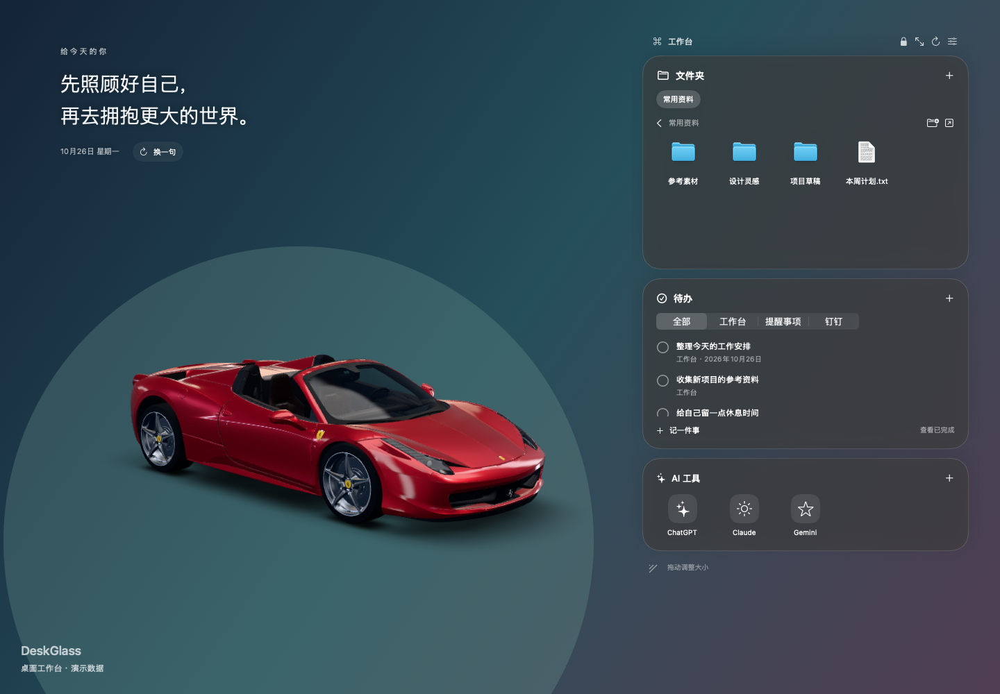

# DeskGlass

A native macOS desktop workbench for your folders, tasks and AI shortcuts, with translucent glass panels and interactive offline 3D companions.

[简体中文](README.md) · [Download](https://github.com/zhongqingqiang01-ship-it/DeskGlass/releases/latest) · [Usage](docs/USAGE.md) · [Issues](https://github.com/zhongqingqiang01-ship-it/DeskGlass/issues)



## Features

- Pin folders, browse files, reorder tiles, rename, create folders, move files and send them to the Trash with confirmation. Existing files are never overwritten by move or rename operations.
- Local tasks with due dates and completion state; optional read-only Apple Reminders and DingTalk integrations.
- Website and native app shortcuts, including ChatGPT, Claude and Gemini defaults.
- Locked-by-default layout, resizing, adjustable glass density, primary-display positioning and a global shortcut.
- An offline interactive Ferrari and an original procedural robot puppy that fetches, eats, performs tricks and sleeps.
- Local data storage; no project-operated account system, backend or analytics.

## Install

The downloadable build targets **Apple Silicon and macOS 14+**. The application UI is in Simplified Chinese. Intel builds are possible from source but have not been validated on physical Intel hardware.

Download `DeskGlass-0.1.0-macos-arm64.zip` from [Releases](https://github.com/zhongqingqiang01-ship-it/DeskGlass/releases/latest), unzip it and move `桌面工作台.app` to Applications. The app lives in the menu bar. Press **Control + Option + Space** to bring it above other windows and **Command + ,** to open settings.

The release is ad-hoc signed, without Apple Developer ID signing or notarization. If macOS blocks it, review the download source and the app-specific **Open Anyway** option in System Settings → Privacy & Security, or build locally. Do not disable system-wide protections.

## Build

```sh
xcode-select --install # only if Command Line Tools are not installed
git clone https://github.com/zhongqingqiang01-ship-it/DeskGlass.git
cd DeskGlass
./build.sh
open "dist/桌面工作台.app"
```

Ordinary builds require no Node.js or model downloads. SwiftUI, AppKit, EventKit, Carbon and WebKit come from the macOS SDK.

```sh
./test.sh
./test-stage.sh # opens a temporary WebKit validation window
./scripts/package.sh
```

Only renderer development requires Node.js 20+: `npm ci && npm run build:stage && npm test`. See [development notes](docs/DEVELOPMENT.md).

## Privacy and assets

Workspace data is stored at `~/Library/Application Support/DeskGlass/workspace.json`; layout and companion state use macOS preferences. External integrations are opt-in and read-only. DingTalk requires a separately installed, compatible `dws` CLI and your own account; it is not required for the other features.

Original code is MIT licensed. The bundled Ferrari model is by vicent091036 under **CC BY 4.0**; three.js retains its MIT license. See [third-party notices](THIRD_PARTY_NOTICES.md). The software license does not relicense third-party artwork or trademarks.

No Gundam model, texture, source download or promotional footage containing that restricted asset is included. The independently authored animation adapter remains available for compatible, appropriately licensed local assets only.

Contributions and bug reports are welcome. See [CONTRIBUTING](CONTRIBUTING.md).
